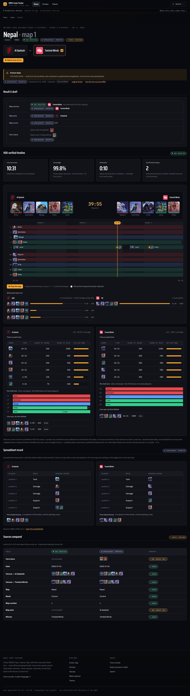
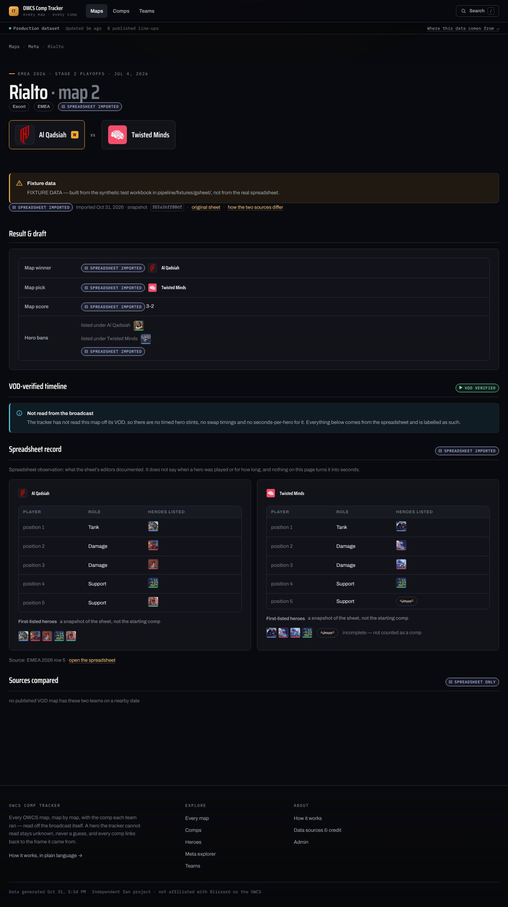
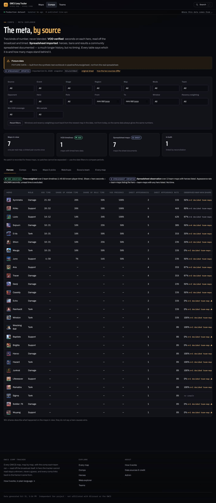
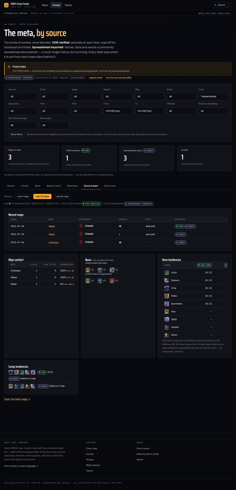
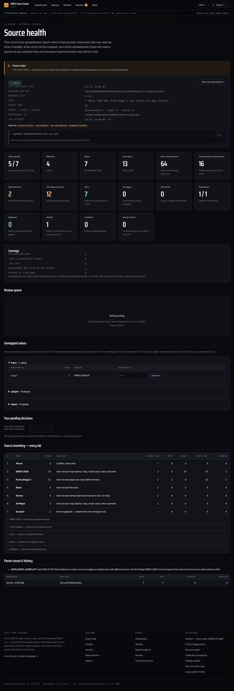
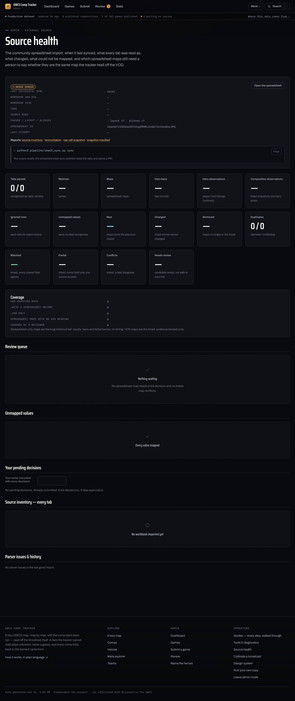
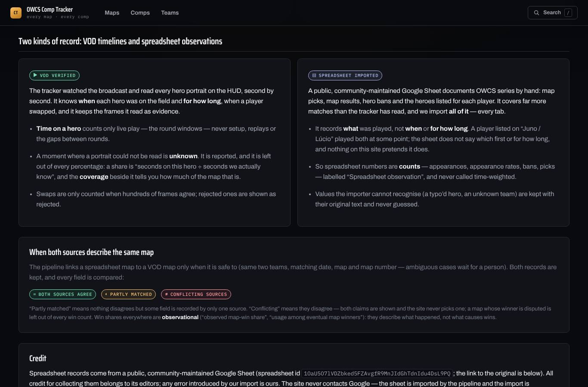

# The community spreadsheet — an external, labelled source

OWCS Comp Tracker reads hero compositions off broadcast VODs: exact stints,
seconds per hero, swaps with evidence frames. A public, community-maintained
Google Sheet
([`1OaU5O7lVDZbked5FZAvgfR9MnJIdGhTdnIdu4DsL9PQ`](https://docs.google.com/spreadsheets/d/1OaU5O7lVDZbked5FZAvgfR9MnJIdGhTdnIdu4DsL9PQ/edit?usp=sharing))
documents a much longer history by hand: series, map order, map picks, map
results, hero bans and the heroes listed for each player.

This document covers how the sheet is brought in as its own **external
layer**: imported in full, kept apart from the VOD record, compared with it
field by field, and labelled on every page.

## Source-of-truth rules

| | VOD verified (`public_data.v1.js`) | Spreadsheet imported (`external_sheet.v1.js`) |
|---|---|---|
| Hero stint start/end, swap timing | **authoritative** | never: the sheet has no time |
| Hero player-seconds, time-weighted rates, comp duration | **authoritative** | never: counts only |
| Evidence frames, detection confidence, coverage | **authoritative** | none |
| Event / stage / region metadata | as recorded with the VOD | as the sheet's editors wrote it |
| Teams, series score, map order, map, mode, result | as recorded with the VOD | as the sheet's editors wrote it |
| Hero bans, map pick | when captured | as the sheet's editors wrote it |
| Player-level listed heroes, listed comps | n/a | **appearances / observations**, untimed |

* Nothing from the sheet overwrites a VOD-derived, reviewed or published record.
* "Up to three heroes per player" stays `ExternalPlayerHeroAppearance` rows with a
  `listOrder`. No seconds and no play order are ever derived from it.
* When both sources describe a map, both claims are kept and every field is
  compared. The record gets `matched`, `partial`, `conflict`, `unmatched` or
  `needs_review`. Nothing is silently chosen. A map whose winner is disputed is
  left out of every win count, and the page says so.
* Every public number carries a badge: **VOD verified**, **Spreadsheet imported**,
  **Both sources agree** or **Conflicting sources**. Credit to the sheet's editors
  and a link to the original are on `how-it-works.html#sources`.

## Architecture

```
   GitHub Actions (daily, sheet-sync.yml)  or  python3 pipeline/sheet_sync.py sync
                │   public xlsx export URL — no API key; the site never calls Google
                ▼
   fetch.py ── SHA-256 ── unchanged vs manifest.lastGood? ── yes ─► stop, write nothing
                │ no
                ▼
   workbook.py  every tab, every cell, merged ranges, hyperlinks
                ─────────────────► data/external/gsheet/raw/  index.json + sheets/*.json.gz (RAW layer)
                ▼
   layout.py    per tab: header row (incl. two-row headers) → columns → purpose
   aliases.py   teams (+history windows) · players · heroes (renames) · maps · modes
                · regions · stages · dates      ◄── config/external/aliases.json
                                                ◄── corrections/external_reconciliation.json
   normalize.py raw → External* records + SourceFieldProvenance
                validation gate: unrecognised layout / mostly-unparseable tab /
                removed or re-purposed tab ⇒ FAIL, keep last good import
                ─────────────────► data/external/gsheet/normalized.json.gz
                ▼
   reconcile.py scored matching vs published VOD maps (assets/data/public_data.v1.js)
                auto-link only when unambiguous; otherwise review queue
                ▼
   export.py    ─► assets/data/external_sheet.v1.js   (window.OWCS_EXTERNAL)
                ─► reports/external/gsheet/{inventory,reconciliation,last_failure}.{json,md}
                ─► data/external/gsheet/manifest.json (snapshot ledger)
                ▼
   PR on branch auto/sheet-sync  ──(a person merges)──►  GitHub Pages

   Browser:  public_data.v1.js ┐
                               ├─ app/metastats.js (one entry per real map; lanes kept apart)
   external_sheet.v1.js ───────┘    ├─ map.html       scouting page (VOD lane | sheet lane | compared)
                                    ├─ meta.html      filterable meta explorer
                                    ├─ team.html      recent-match scouting report
                                    └─ sheet-sync.html  admin Source health + review queue
```

The VOD side gained one module, `pipeline/time_weighting.py`. It turns the
**same** published `heroStints` and `maps[].rounds` that `mapstory.js` already
draws into seconds. There is no second timeline model.

## Commands

```bash
python3 pipeline/sheet_sync.py sync              # download → import → reconcile → export
python3 pipeline/sheet_sync.py import --xlsx F   # same, from a local workbook (offline)
python3 pipeline/sheet_sync.py inventory --xlsx F  # what each tab would be read as (no writes)
python3 pipeline/sheet_sync.py rebuild           # re-parse the COMMITTED raw layer (no download)
python3 pipeline/sheet_sync.py check             # CI gate: committed layer == rebuild (exit 1 on drift)
python3 pipeline/sheet_sync.py status            # last sync, counts, reconciliation summary
python3 pipeline/sheet_sync.py fixture --out DIR # preview the whole chain on the synthetic workbook
python3 pipeline/export_data.py --public         # VOD export; also refreshes the external export
```

Exit codes: `0` ok/unchanged, `1` drift (`check`), `2` sync/import failed.

Run `rebuild` after you edit `config/external/*.json` or commit a reconciliation
decision. `export_data.py --public` re-reconciles automatically, because which
VOD maps are published changes the links.

## Files

| path | what | written by |
|---|---|---|
| `config/external/gsheet_source.json` | sheet id, URLs, credit text, `maintainer` (null until a human confirms) | hand |
| `config/external/gsheet_layout.json` | header spellings, column families, tab purposes, forward-fill fields | hand, versioned |
| `config/external/aliases.json` | canonical spellings for every entity, date formats | hand, versioned |
| `config/comp_archetypes.json` | editorial archetype labels (tank-based) | hand, versioned |
| `corrections/external_reconciliation.json` | link/reject/ignore decisions, alias approvals | the Source health page builds entries; commit them |
| `data/external/gsheet/raw/index.json` + `raw/sheets/NNN-<tab>.json.gz` | raw layer: every tab and cell of the last good workbook, one deterministic gzip per tab (keeps every file far under GitHub's 100 MB limit; a sync that changes one tab adds one new blob) | `sync` |
| `data/external/gsheet/normalized.json.gz` | External* records + field provenance + inventory (deterministic gzip: a full sheet is tens of MB of JSON) | `sync`, `rebuild` |
| `data/external/gsheet/manifest.json` | every snapshot: sha256, date, bytes, tabs, versions, counts, changes; `lastGood`, `lastAttempt` | `sync` |
| `reports/external/gsheet/*` | source inventory, reconciliation, last failure (md + json) | `sync`, `rebuild` |
| `assets/data/external_sheet.v1.js` | the public external dataset: compact, one line per map | `sync`, `rebuild`, `export_data.py --public` |
| `assets/data/external_sheet/detail-<xx>.js` | per-map player listings, loaded only by `map.html` | `sync`, `rebuild` |
| `work/gsheet/owcs-sheet_<date>_<sha12>.xlsx` | the original bytes (git-ignored; also a workflow artifact for 30 days) | `sync` |

Old snapshots stay recoverable from git history (`raw/` at any commit)
and are listed by hash in the manifest. A parser improvement is just `rebuild`.
Nothing needs downloading again.

## How a worksheet is read

No tab name and no column letter is hard-coded. For **every** tab:

1. The header row is the row, within the first `headerScanRows`, whose cells
   match the most known header names. A merged group label above a sub-header
   is combined with it: `Team 1` over `Ban` reads as `team 1 ban`. Header text
   is normalised first, so `Map #` reads as `map no`.
2. Each column becomes a single field (`date`, `map`, `winner`, …) or a member
   of a repeated family (`ban` side a #1, `player_hero` side b Support p5,
   `long_hero` #2, …).
3. The purpose follows from the fields present:
   * `player_rows`: one row per player per map
   * `ban_rows`: one row per ban
   * `map_rows`: one row per map, possibly with ban and hero columns
   * `match_rows`: one row per series
   * `credits`: a tab with "made by …" text
   * `unrecognised`: preserved in the raw layer and listed in the inventory,
     never parsed
4. Rows are parsed in that dependency order, so long-format rows can attach to
   maps. A blank row, a repeated header row and a junk row (`Total`) are
   skipped, and every skipped row is listed with its reason. Dates, events,
   stages and regions written once over a block are forward-filled, with
   provenance saying so. **Team names are never forward-filled**: a row with a
   blank team is reported, not attached to the row above. Merged cells are
   expanded, and provenance records the origin cell.
5. A cell like `Juno / Lúcio` becomes two appearances, `listOrder` 1 and 2.
   Separators are configurable.

**The gate fails the import and keeps the last good data when:** no tab is
recognised; a recognised tab yields no map; more than `maxIgnoredRowShare`
(50%) of a data tab's rows are unparseable; or a tab that held data in the last
good snapshot is gone or now reads as something else. Pass
`--accept-structure-change` only after reviewing the inventory.

## Data contract — `window.OWCS_EXTERNAL` (`external.v1`)

| key | shape |
|---|---|
| `meta` | `{schema, fixture, status, parserVersion, provenanceLabels, note, fixtureNote}`. `status` is one of `ok`, `never-synced`, `failed-kept-last-good`, `failed-never-good` |
| `source` | `{id, label, spreadsheetId, viewUrl, exportUrl, maintainer, creditNote, creditsFound[{sheet,cell,text}]}` |
| `snapshot` | last good import `{sha256, importedAt, bytes, sheetNames, parserVersion, layoutVersion, aliasesVersion, sourceRowCount, counts, changes, sourceUrl}`, or `null` |
| `lastAttempt` | `{at, status, stage?, reason?, sha256?}` |
| `history[]` | the last 10 snapshots `{sha256, importedAt, status, counts, changes}` |
| `teams` | `{id: {id, name, mapped}}`: the sheet's own spelling for teams no registry knows (ids `x-<slug>`) |
| `tournaments[]` | **ExternalTournament** `{id: "xt-<slug>", slug, name, nameMethod, regions[], stages[], year}` |
| `matches[]` | **ExternalMatch** `{id: "xm-<hash>", slug, tournamentId, event, stage, stageRaw, region, regionRaw, date, dateRaw, dateMethod, dateAmbiguous, patch, teamA/teamARaw/teamAMethod, teamB…, seriesScoreA/B, seriesScoreRaw, seriesScoreMethod ("sheet" or "derived-from-map-winners"), winner, winnerMethod, mapIds[], flags[], src}` |
| `maps[]` | **ExternalMap summary**, one line per map: `{id: "xmap-<hash>", slug, matchId, date, order, map, mapRaw (only when unmapped), mode, teamA, teamB, winner, winnerSide, pickedBy, pickNote, scoreRaw, vodUrl, flags[], duplicateConflicts? (count), bans[], teams{a,b}}` |
| `maps[].bans[]` | **ExternalHeroBan** `{side, teamId, hero, raw?}`. `hero` missing means unmapped and never counted; `raw` keeps the sheet's text |
| `maps[].teams.<side>` | `{heroes[] (every resolved hero the sheet lists for that team), comp[5] or null (its complete five-hero listing), compKind ("listed-comp" or "first-listed"), listed, unresolved}`. Counts and sets only: **there are no time fields anywhere** |
| `detailShards[]` | buckets that exist under `assets/data/external_sheet/` |
| `assets/data/external_sheet/detail-<xx>.js` | `window.OWCS_EXTERNAL_DETAIL[mapId]`: the full map, including `src{sheet,row,cells}`, `alsoListedAt[]`, `duplicateConflicts[]`, bans with `cell`, and `teams.<side>.players[]` (**ExternalPlayerHeroAppearance**: `{position, player, playerRaw, playerMapped, role, heroes[{hero, n, raw?}]}`, where `n` is the sheet's list order, **not** play order) plus `comps[]` (**ExternalCompositionObservation**: `{kind, heroes[], unresolved[], complete}`). `xx` is characters 6–7 of the map id, so there are at most 256 small files however big the sheet is. Only `map.html` loads them, for one map at a time |
| `reconciliation` | `{summary, rules, vodOnlyMaps[], records[]}` |
| `reconciliation.records[]` | Every record with a link, a candidate, a decision or a non-`unmatched` status. Plain "no candidate" records are counted in `summary` only. **ReconciliationRecord** `{id, externalMapId, vodMapId, status, method ("auto" or "manual"), score, candidates[{vodMapId, score, reasons[], mapDisagrees}], fields{date, map, order, mode, winner, pickedBy, bans, heroes:<team>{sheet, vod, agree, note, sheetOnly[], vodOnly[], vodOnlyBrief[]}}, decisions[], ignored, reason}`. `agree` is `true`, `false`, or `null` (only one source recorded it) |
| `decisions` | every committed manual decision and alias approval, carried into export provenance |
| `health` | `{counts, tabCount, dataTabs, sourceRowCount, layoutVersion, aliasesVersion, tabs[], unmapped{kind:[{raw,count,refs}]}, issues[], errors[]}` |

`normalized.json.gz` holds the same records flat and un-nested, the original text
for every value, and `fieldProvenance[]` (**SourceFieldProvenance**:
`{record, field, sheet, cell, method, raw, value}`, where `method` is one of
`direct`, `alias`, `catalog`, `approved`, `history`, `slug`, `forward-fill`,
`merged-cell`, `row-sequence`, `derived-from-map-score`, …).

**IDs** are content-keyed (date + both teams, then map number), so inserting
or reordering unrelated rows never moves them. Slugs read like
`2026-07-04-qadsiah-vs-twis-m1-nepal`. Correcting a team's spelling so that it
resolves to a different team gives a new id. That is intended: it is a
different claim.

## Reconciliation scoring

A candidate VOD map must have **the same two resolved teams**. Then:

| evidence | points |
|---|---|
| same two teams | +4 |
| same date | +3 |
| dates 1 day apart (time zones) | +2 |
| dates 2–3 days apart | +0.5 |
| dates more than 3 days apart | rejected |
| same map | +3 |
| different map | −3, and blocks auto-link |
| same map number | +2 |
| different map number | −1 |
| event/stage wording overlaps | +1 |
| same VOD video id | +3 |
| different VOD video id | −2 |

* **Auto-link** needs ≥ 9, a lead of ≥ 3 over the runner-up, and no disagreeing map.
* A score of 5 or more that misses those conditions goes to **needs_review** with
  every candidate and its reasons.
* Two sheet maps that would link to one VOD map are both sent to review.
* Heroes compare as sets. A hero the sheet lists that the VOD never shows for
  that team is a **conflict**. A hero the VOD shows for at least 30 s that the
  sheet does not list makes the field **one-source**. Shorter VOD appearances
  are noted, not counted against the sheet.

## Time-weighted VOD analytics (`public_data.v1.js` → `timeWeighting`)

`pipeline/time_weighting.py`:

* **What is counted.** Only published stints, and only inside detected round
  windows (`liveWindowSource: "rounds"`). Recorded offsets are inclusive whole
  seconds and are converted once to `[start, end+1)`.
* **Unknown time.** A live second with no stint is unknown, reported as
  `unknownPlayerSeconds`, and excluded from every share.
* **Denominators** (all stated in `timeWeighting.method.denominators`):
  * `shareOfTeamKnownSeconds` = hero s ÷ the team's known player-seconds
  * `shareOfRoleKnownSeconds` = hero s ÷ the team's known seconds on that role
  * `presenceShare` = hero s ÷ live seconds
  * `coverage` = known ÷ (live × HUD slots)
  * `presenceRate` = team timelines with the hero ÷ all team timelines
* **Per map** you get: per-team hero seconds, per-slot seconds (HUD slot, not
  player — the HUD does not name players), complete line-ups with seconds,
  archetype seconds, confirmed swap counts, winner/loser exposure, and
  `auditedSeconds` (confirmed/strong tiers).
* **Aggregates:** `heroes[]` and `lineups[]` (by verified duration, with
  winner/loser seconds).
* **Fallback.** A map with no detected rounds falls back to its stint span and
  is labelled `stint-span`, because that includes non-live time.

## First-time setup (in order)

1. **Merge the code into `main`.** GitHub only lists a workflow once it is on
   the default branch. Open the PR:
   <https://github.com/cvree/OWCSComp.Tracker/compare/main...claude/charming-hamilton-hc7xxu>
   → *Create pull request* → wait for the `ci` check → *Merge*.
2. **Let workflows open pull requests.**
   <https://github.com/cvree/OWCSComp.Tracker/settings/actions> → *Workflow
   permissions* → *Read and write permissions* + tick *Allow GitHub Actions to
   create and approve pull requests* → *Save*.
3. **Run the first sync.**
   <https://github.com/cvree/OWCSComp.Tracker/actions/workflows/sheet-sync.yml>
   → *Run workflow* → branch `main` → *Run workflow*. Click the run when it
   finishes (a few minutes).
4. **Green run → review the import.**
   <https://github.com/cvree/OWCSComp.Tracker/pulls?q=is%3Apr+head%3Aauto%2Fsheet-sync>
   → open *Spreadsheet import: workbook …* → read the tab table and the
   reconciliation summary in the description → *Merge*. The site redeploys
   on its own.
5. **Red run → teach the importer the new headers.** On the run page, the
   *Summary* shows every tab and the headers it saw; the
   `sheet-sync-<id>` artifact at the bottom has the downloaded workbook.
   Add the spellings to
   <https://github.com/cvree/OWCSComp.Tracker/edit/main/config/external/gsheet_layout.json>
   (`fields` / `groups`, bump `version`), commit, and repeat step 3.
6. **Work the review queue.** <https://cvree.github.io/OWCSComp.Tracker/sheet-sync.html>
   → type your name → approve aliases / link or reject candidates →
   *Download the merged corrections/external_reconciliation.json* → upload it
   over <https://github.com/cvree/OWCSComp.Tracker/blob/main/corrections/external_reconciliation.json>
   → then run `python3 pipeline/sheet_sync.py rebuild` and commit (or just
   re-run step 3 with *force* ticked).
7. **Credit the maintainer** once confirmed: set `"maintainer"` in
   <https://github.com/cvree/OWCSComp.Tracker/edit/main/config/external/gsheet_source.json>.
8. **Check it live:** <https://cvree.github.io/OWCSComp.Tracker/meta.html>,
   any map's *Scout* button on <https://cvree.github.io/OWCSComp.Tracker/>,
   and <https://cvree.github.io/OWCSComp.Tracker/how-it-works.html#sources>.

After that it runs daily on its own; you only merge the PR it opens.

## Operator runbook

* **Daily:** `sheet-sync.yml` runs at 10:41 UTC. It does nothing if the
  workbook hash is unchanged. Otherwise it opens or updates the PR on
  `auto/sheet-sync`, with the inventory and reconciliation summary in the body.
  **Review it and merge it.** It never auto-merges.
* **Sync failed:** the job is red and the job summary shows
  `reports/external/gsheet/last_failure.md`. Nothing was committed and the
  site keeps the last good import. If the layout changed:
  1. Download the artifact's xlsx.
  2. Run `sheet_sync.py inventory --xlsx …`.
  3. Add the new header spellings to `gsheet_layout.json` and bump `version`.
  4. Re-run the workflow, with `accept_structure_change` only if a tab was
     really renamed or removed.
* **Unmapped values / review queue:** open `sheet-sync.html` (admin).
  1. Approve aliases and link/reject/ignore candidates. Your decisions collect
     on the page.
  2. Download the merged `corrections/external_reconciliation.json` and commit it.
  3. Run `sheet_sync.py rebuild`.
  4. Commit the result.
* **Credit:** once the maintainer is confirmed, set `maintainer` in
  `config/external/gsheet_source.json` and rebuild. Until then the site quotes
  any credit text the workbook itself carries, with its cell.

## Migration notes

* There are **no SQLite schema changes**. The external layer is committed JSON,
  like the discovery layer. `data/owcs.sqlite` is untouched.
* `public_data.v1.js` gains one key, `timeWeighting`, and nothing existing
  changed. Re-export with `export_data.py --public`.
* There is a new dependency, `openpyxl>=3.1`, which is pure Python.
  `pip install -r requirements.txt`.
* There are new pages:
  * `map.html` and `meta.html`: public, reached from Maps and Comps. No new
    nav slot.
  * `sheet-sync.html`: admin rail.
  * The name `sources.html` stays retired, as `test_site.py` requires.
* Workflows that run `export_data.py --public` now also stage
  `assets/data/external_sheet.v1.js`, which that command refreshes. `ci.yml`
  runs `sheet_sync.py check`.
* Until the first real sync lands, `external_sheet.v1.js` is the honest
  `never-synced` state. Pages say the spreadsheet has not been imported yet and
  show VOD data only.

## Limits

* **Size.** The real workbook is over 50 MB. Downloads are capped at
  `maxDownloadBytes` (300 MB) in `gsheet_source.json` as a runaway guard.
  Every file the import would commit is size-checked first (95 MB, under
  GitHub's 100 MB limit). An oversize file fails the sync at stage `store`
  and keeps the last good data. The inventory's *Workbook package* line
  shows what makes the file large (embedded images versus very large tabs).

* The real workbook's layout could not be inspected while this was built,
  because the build environment's network policy blocked `docs.google.com`.
  The importer is header-driven and fails loudly rather than guessing. The
  first real sync (the workflow, which has open egress) is what proves the
  layout config. If it fails, its inventory says exactly which headers need
  adding.
* The sheet's ban columns are reported "as listed under a team". Whether a team
  column means "banned by" or "banned against" is the sheet's own convention.
* Patch data exists only if the sheet records it. Without it, the meta explorer
  says patches cannot be separated and offers date filters.
* Composition archetypes are editorial labels from the tank hero
  (`config/comp_archetypes.json`). They are not detections.
* All win shares are observational, never causal.

## Screenshots

Files named `*.fixture.jpg` were rendered from the **synthetic** fixture
import (`sheet_sync.py fixture`), not from the real spreadsheet. Only the
Nepal row mirrors a real VOD map, so that reconciliation has something real
to link to. The other two show the committed, never-synced state.

| | |
|---|---|
|  | Map page: result and draft per source, the VOD timeline (reused map story), seconds per hero and HUD slot, line-ups by duration, the spreadsheet's listed heroes, and "Sources compared" (partly matched: bans and pick are sheet-only) |
|  | A map only the sheet records: no time anywhere, the typo “Jnuo” kept and struck, an incomplete listing not counted as a comp |
|  | Meta explorer: VOD time shares beside sheet appearance rates, sample sizes flagged |
|  | Scouting report: window, per-source coverage, comfort, bans, heroes, comps |
|  | Admin Source health: sync status, hash, counts, coverage, review queue, unmapped values, per-tab inventory |
|  | The committed state before the first real sync |
|  | Public methodology and credit |
